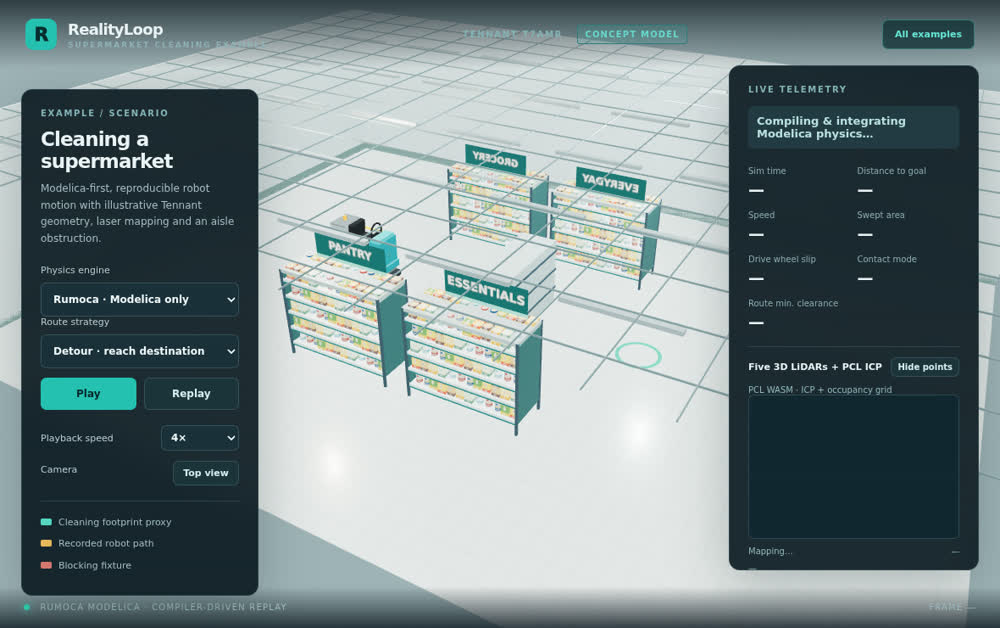

# RealityLoop

**Standalone robotics simulation and experimentation platform.** All normal simulations run through the canonical Taskyon Design Graph engine. **Taskyon UI, cloud services, Space and P2P are not required** to execute, record, inspect or cache experiments. Taskyon/P2P integration is a future optional *transport and visualization* concern—not a runtime dependency.

## Run

```sh
npm ci
npm run dev                  # local browser example gallery
npm run sim -- examples      # list examples
npm run sim -- scenarios/modelica-supermarket-detour.json runs/detour
npm run sim -- scenarios/modelica-wheel-breakaway.json runs/wheel
npm run sim -- verify "$INVOCATION_ID" runs/.dag  # separate uncached replay proof
npm run check && npm test && npm run build && npm run build:web
```

The root page lists independent examples: supermarket cleaning and wheel traction. Start the Vite test server with `npm run dev -- --port 5174` (local only) and open `http://localhost:5174/`. The supermarket is at `/examples/supermarket.html` and the traction lab at `/drive-lab.html`; neither is the definition of RealityLoop. Use `npm run dev -- --host 0.0.0.0 --port 5174` only on a trusted network.

## Design Graph is mandatory; P2P is optional

Both the headless CLI and browser examples use the **real Taskyon `@taskyon/comp-dag` node engine**. The module is bundled offline in `src/vendor/taskyon-comp-dag.mjs` from `frontend/packages/comp-dag`, with a recorded source and bundle lock at `src/vendor/taskyon-comp-dag.lock.json`. This is a temporary standalone packaging solution, not a second graph implementation. Rebuild only when intentionally updating canonical Taskyon sources:

```sh
npm run build:dag-runtime     # requires local Taskyon source checkout; not needed to simulate
```

The graph is `RealityLoop.Scenario → RealityLoop.Simulation → { RealityLoop.Metrics, RealityLoop.Observations }`. A validated scenario is an invocation input, a simulation result is a Taskyon content-addressed artifact, and derived metrics and sensor observations are separate cached artifacts. The **v2 execution lock** fingerprints every implementation file under `src/`, the dependency lockfile, the selected Modelica source, Rumoca WASM, the canonical DAG bundle and Node runtime version/platform. The filesystem backend implements Taskyon's injected `DagStorageBackend` and `DesignGraphObjectStore` interfaces and persists **Taskyon-format** `GraphRevision`, `InvocationDefinition`, `InvocationRun` and `ProjectRevision` objects under `runs/.dag/`. Repeat runs reuse the local DAG cache; changed inputs or physics sources create distinct invocations. Local filesystem writes currently assume a **single writer**; concurrent workers require a transactional adapter.

Each headless run writes:

- `result.json` — trajectory, metrics and acceptance results
- `sensor-observations.json` — deterministic synthetic IMU/encoder samples, camera metadata and time-sampled 3D LiDAR point clouds where the trajectory exposes a vehicle pose; unrelated experiments explicitly report no sensors
- `run-integrity.json` — input/model/compiler digests, Taskyon graph/invocation/run/project identities and artifact hashes

**Independent replay verification:** `realityloop verify <invocation-id> [store-dir]` reads a stored Taskyon invocation and its artifacts, rejects changed source/runtime locks and corrupt artifacts, then recomputes the physics through a **fresh, uncached DAG store** and compares trajectory, metrics and sensor hashes. The invocation ID is printed by the CLI and recorded in `run-integrity.json`. A cache hit alone is not replay verification. Bit-exact replay across different platforms or solvers is not yet guaranteed.

The browser uses the same canonical DAG nodes, currently with **in-memory caching**. Its lock includes embedded implementation sources, the bundled DAG identity and a digest of the actual Rumoca WASM binary. Persisting/browser-exporting complete Taskyon run records, syncing via P2P, and importing them into Taskyon UI remain outstanding. **Canonical GraphRevision records currently identify trusted bundled nodes, not portable compiled NodeRecords with full module locks**; a Taskyon UI import adapter and module-lock compatibility test are still needed. No external service or network is required for the Node CLI.

## Supermarket example

The Tennant T7AMR-inspired vehicle is **not** a manufacturer model or validated BrainOS implementation. The default Rumoca/Modelica plant owns its planar front-steer/wheel-slip dynamics and analytic contacts with all four stocked shelves plus an aisle obstruction. The smooth detour reaches the goal in about 14.8 simulated seconds with roughly 0.18 m projected swept clearance. Acceptance requires a goal and ≥0.10 m swept-footprint clearance. Legacy Rapier remains opt-in for comparison; no second dynamics engine integrates the same vehicle.

Five synthetic 3D LiDAR point clouds feed a PCL.js WASM ICP scan-registration/2D occupancy demonstrator. The example also renders a front RGB camera and produces IMU/encoder samples; rear RGB and depth streams currently contain metadata rather than image pixels. This is **not** full SLAM with loop closure. Sensor positions and noise are not Tennant-calibrated.

**PBR visualization:** The supermarket browser viewer now renders a supermarket interior inspired by actual grocery aisle photography: tiled polished floor, reflective steel shelf fixtures, dense instanced product packaging, hanging linear LEDs, category boards, acoustic-tile ceiling and cutaway walls. The 480 illustrative products and architectural meshes are *render-only*, never additional collision or LiDAR surfaces. A one-time low-resolution reflection panorama avoids per-frame render probes. Graphics: **Auto / High PBR / Balanced / Performance**; Auto selects the lower-cost path on software WebGL and downshifts on sustained low FPS. The footer shows FPS, draw calls and product count. Headless software rendering was measured near 4 FPS at 800×520 in Chromium; this is **not** representative of real GPU performance, which remains to be measured. The reconstruction is inspired by supermarket photos, not a photogrammetric or dimensionally accurate reconstruction.



## Offline H.264 video export (no browser)

`RealityLoop.OfflineVideo` is a **derived Taskyon DAG node**. It consumes an existing recorded `RealityLoop.Simulation` artifact, renders RGB frames in Node.js and streams them directly into FFmpeg. It never reruns Modelica and does not require Chromium, WebGL, Taskyon services or P2P. The output is a **diagnostic 2D top-down trajectory video** for spatial runs or a numeric time-series video for non-spatial experiments; it does *not* yet render the Three.js PBR scene. Video bytes are stored content-addressed under `runs/.dag/media/`, with a canonical video invocation/run and a manifest artifact documenting the codec, encoder version, source invocation, source trajectory hash and renderer hash.

```sh
npm run sim -- scenarios/modelica-supermarket-detour.json runs/detour
INVOCATION_ID=$(node -p "require('./runs/detour/run-integrity.json').dag.invocationId")
# FFmpeg must be available on PATH (or pass --ffmpeg /path/to/ffmpeg):
npm run video -- "$INVOCATION_ID" runs/detour.mp4 --fps 15 --size 960x540
# On NixOS if ffmpeg is not installed:
nix shell nixpkgs#ffmpeg -c npm run video -- "$INVOCATION_ID" runs/detour.mp4
```

An optional end-to-end test exercises actual H.264 encoding with `REALITYLOOP_TEST_FFMPEG=/path/to/ffmpeg npm test`. Source video/artifact integrity is checked independently of the physics simulation.

## MuJoCo / Modelica status

Official `@mujoco/mujoco@4.0.1` WASM separately supports `mj_kinematics` + `mj_collision` contact queries against all five fixtures, without `mj_step`. A **verified opt-in developer probe** in `modelica/RealityLoopMuJoCoHost.mo` uses a patched Rumoca WASM runtime to call official MuJoCo from **inside a Modelica `external "C"` function**. The scalar 3×Real→Real callback returned depth to the Modelica DAE (85 calls and 0.505 m penetration in a deliberate collision test). To reproduce: `npm run build:rumoca-host && npm run test:mujoco-modelica` with the locally patched Rumoca source and appropriate Rust/wasm-bindgen toolchain.

**Limitations:** the full native C shim and `ExternalObject`/contact-array interface are source-only and not compiled/linked; the supermarket still runs analytic Modelica contacts. General native/WASM C ABI support remains a separate architecture goal. The sensor viewer, shell CLI and Taskyon DAG do not substitute JS physics integration for Modelica equations.

## Next steps

Package `@taskyon/comp-dag` as a stable, independently versioned consumer library instead of the pinned bundle; persist browser run records; make generated scenes, assets, controllers and sensor calibrations explicit source-locked graph inputs; optionally publish artifacts into a user-authorized Taskyon Space; and add an optional GPU/PBR-capable offline frame renderer while keeping the current browser-free diagnostic renderer. Physical fidelity, complete 3D collision, robust GPU performance and proper SLAM/pose graph remain separate tasks.

RealityLoop is an independent Git submodule. No changes are pushed automatically. The parent workspace holds the requirements in `../SYSTEM_DEFINITION.csv` and `../proposals/realityloop-simulator-v071.md`.
