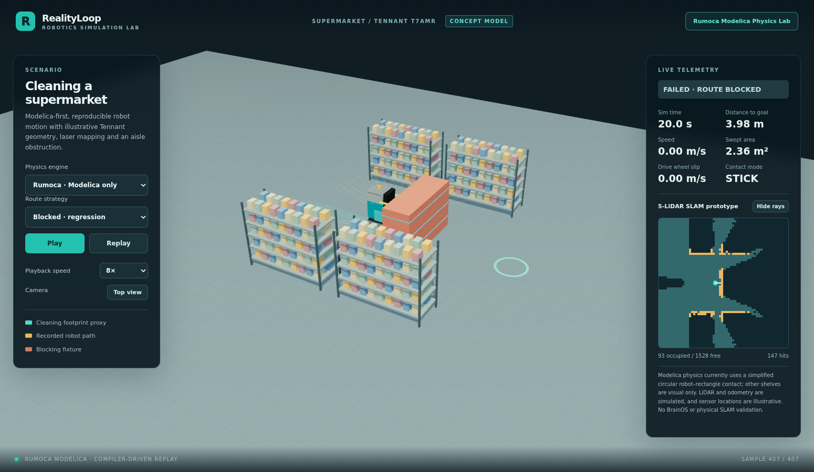
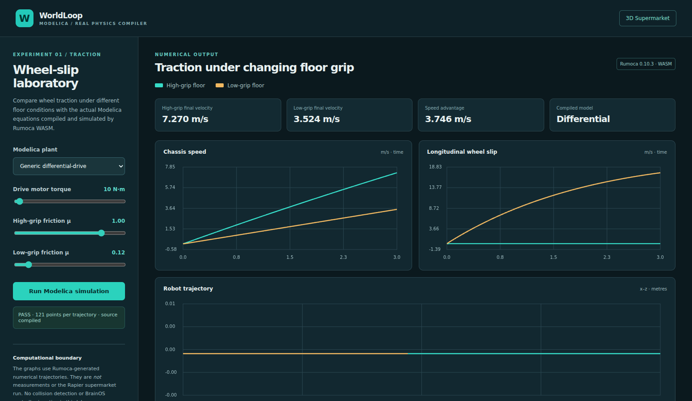

# RealityLoop

Customer-owned, repeatable robotics simulation and AI-agent evaluation. **Status:** Taskyon v0.7.1 prototype, not certified Tennant/BrainOS software.

## Run the simulator

```sh
npm ci
npm run dev                 # http://127.0.0.1:5173/
npm run build:web           # standalone static pages in dist-web/
```

The main supermarket viewer now defaults to **Rumoca/Modelica** and offers Rapier as an opt-in legacy comparison. Its editable Tennant T7AMR-inspired ride-on scrubber, stocked shelves, obstruction, route replay, cleaning-footprint proxy, scan rays and occupancy grid run without a Taskyon login.

- **Modelica supermarket:** `RealityLoopContacts.SupermarketRobot` (detour) or `SupermarketBlocked` (failure), compiled and integrated by the pinned Rumoca WASM runtime. Modelica owns steering, front-wheel inertia/longitudinal Coulomb sticking/sliding, planar chassis state and an analytic penalty contact against **one rectangular obstacle**. Other stocked shelving is visible but not physically collidable in this mode. The contact uses a simplified circular chassis; it is not a precise Tennant collider or a general collision engine.
- **Rapier comparison:** an independently simulated, older rigid-body route and traction surrogate available through the *Physics engine* selector. Rapier is **not loaded or stepped** during a Modelica-only scenario. Different physics assumptions mean cross-backend agreement has not been established.
- **Five-LiDAR mapping:** one simulated forward and two simulated side scanners on each side. A deterministic raycaster provides a 2D occupancy-grid map, synthetic odometry and basic local scan matching. This is an educational localization prototype, not production SLAM or actual Tennant sensor calibration.
- **Modelica Drive Lab** (`/drive-lab.html`): compares friction, wheel slip and trajectories with actual Rumoca-compiled Modelica. `RealityLoopContacts.LongitudinalStickSlip` is shared by the standalone wheel bench, front-steer test, and supermarket model.





## Headless verification

```sh
npm run check
npm test
npm run build
npm run build:web

npm run sim -- scenarios/modelica-supermarket-detour.json runs/modelica-detour
npm run sim -- scenarios/modelica-supermarket-blocked.json runs/modelica-blocked  # expected exit 1
npm run sim -- scenarios/modelica-wheel-breakaway.json runs/contact
npm run sim -- scenarios/tennant-detour.json runs/rapier-detour
```

Machine-readable `result.json` includes trajectories, events/contact modes, model and solver identity, contact force, maximum penetration, rough cleaning coverage, and pass/fail. Modelica source is under `modelica/RealityLoopContacts.mo`; the strict scenario allowlist and trajectory validation are in `src/modelica/runtime.ts`. Parameter changes do not execute arbitrary source strings. `@taskyon/rumoca@0.10.3-taskyon.1` is pinned, with ~35 MB compiler WASM downloaded only for Modelica runs.

## Architecture and limitations

The **default supermarket is now Modelica-authoritative within a limited planar test model**, rather than a JavaScript/Rapier timestep coupling. It models one obstruction, not the full shelves, arbitrary contacts, lateral tire constraints, load transfer, suspension, or realistic cleaning. Contact penetration is possible because it uses a compliant penalty force. The low-speed friction law enforces sticking at the level of the modeled constraint, with event-based breakaway/re-stick, but is not a calibrated real tire model. The route controller uses fixed waypoints and has no sensor-based obstacle avoidance; LiDAR/SLAM is currently visualization/estimation, not the robot controller.

Next stages: full supermarket contact geometry, replaceable Modelica collision packages and standard `external "C"` library support in Rumoca; coupled longitudinal/lateral traction and calibrated drive/steering; real sensor timestamping, robust SLAM, route planning on occupancy maps and BrainOS/ROS adapters. More elaborate tire deformation/Pacejka, loop closure and GPU physics remain separately tracked.

Approximate public T7AMR external dimensions are 1.651 m length, 0.889 m width, 1.499 m height and 479 kg mass. [Tennant product reference](https://www.tennantco.com/en_us/1/machines/scrubbers/product.t7amr.robotic-floor-scrubber.2000056.html). The appearance, sensors and dynamics here are not manufacturer-approved.

RealityLoop is an independent Git submodule of the parent workspace at `realityloop/`; no changes are pushed automatically. Parent requirements and the system proposal are in `../SYSTEM_DEFINITION.csv` and `../proposals/realityloop-simulator-v071.md`.
