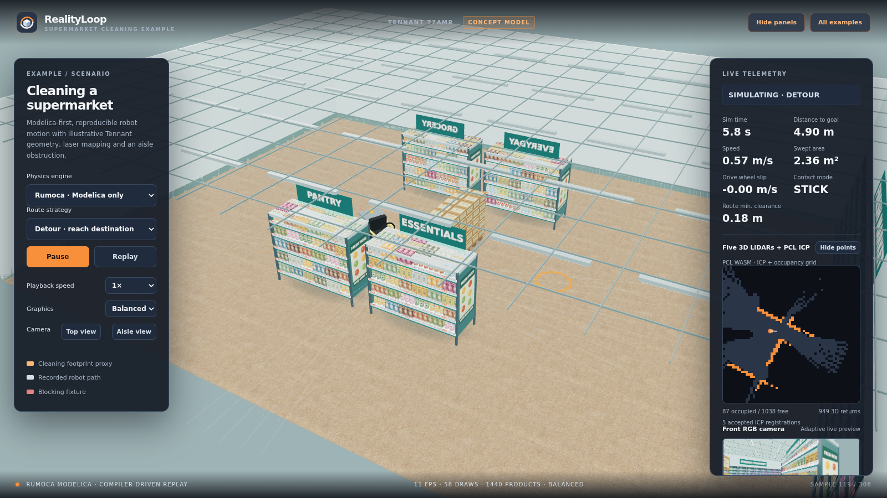
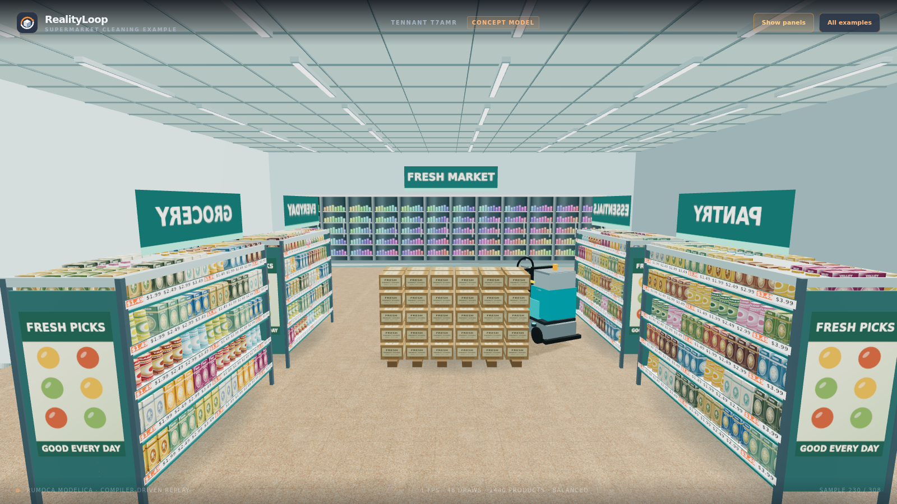

# RealityLoop

**A compiler for physical-world experiments:** describe a scenario, execute its simulation as canonical Design Graph nodes, and verify the results before testing real hardware. The supermarket robot and wheel traction lab are examples, not the limits of RealityLoop. **Taskyon UI, cloud services, Space and P2P are not required** to execute, record, inspect or cache experiments. Taskyon/P2P integration is a future optional *transport and visualization* concern—not a runtime dependency.

## Run

```sh
npm ci
npm run dev                  # local browser example gallery
npm run sim -- examples      # list examples
npm run sim -- scenarios/modelica-supermarket-detour.json runs/detour
npm run sim -- scenarios/modelica-wheel-breakaway.json runs/wheel
npm run sim -- verify "$INVOCATION_ID" runs/.dag  # separate uncached replay proof
npm run check && npm test && npm run build && npm run build:web
```

The root page lists independent examples: supermarket cleaning and wheel traction. Start the Vite test server with `npm run dev -- --port 5174` (local only) and open `http://localhost:5174/`. The supermarket is at `/examples/supermarket.html` and the traction lab at `/drive-lab.html`; neither is the definition of RealityLoop. Use `npm run dev -- --host 0.0.0.0 --port 5174` only on a trusted network.

## Taskyon-family visual identity

The standalone gallery, supermarket controls and traction lab share `viewer/theme.css`, using **primary slate `#2A3548` and secondary orange `#F78F3B`**. The optional Taskyon olive accent is intentionally not part of the everyday RealityLoop interface. Diagnostic overlays use orange and neutral white/slate for distinct data series. The current `public/realityloop-icon.svg` remains the provisional favicon and page mark until the final physical-world identity is selected. Scene materials, robot paint, products and sensor calculations do **not** inherit brand colors.

## GitHub Pages deployment (static demos)

The independent repository has a GitHub Actions workflow at `.github/workflows/pages.yml`. GitHub `main` pushes run TypeScript and simulation tests, build the multi-page Vite gallery at the repository's `/<repository>/` Pages base, verify paths/assets, and **upload the artifact in the build job**. A separate deploy job publishes it to Pages. Workflow dispatch is also supported.

**One-time repository setup is required:** in **GitHub → Settings → Pages → Build and deployment → Source**, select **GitHub Actions**. The initial deployment failed because Pages was not enabled (HTTP 404 in `actions/configure-pages@v5`); the workflow now emits a specific configuration error while preserving the successful build artifact. The standard `GITHUB_TOKEN` cannot enable Pages through `configure-pages`'s `enablement: true` option. Site initialization requires repository administration, not an extra token embedded in the workflow.

The repository has both `github` (`git@github.com:Xyntopia/realityloop.git`) and `origin` (`git@gitlab.com:xyntopia/realityloop.git`) remotes. Only GitHub pushes trigger GitHub Actions. The workflow does not modify remotes or expose credentials; the resulting static site is public.

To test the expected project Pages layout locally:

```sh
npm run build:web -- --base /realityloop/
node --test tests/pages-build.test.mjs
```

Substitute the GitHub repository name for `realityloop` when necessary and set `REALITYLOOP_PAGES_BASE=/your-repo/` for the smoke test. The static Pages site runs existing browser DAG simulations **locally in the tab**. It does not host an always-on agent or expose P2P/RPC endpoints. Authorized Taskyon remote DAG-node execution is a separate **planned v0.7.1** capability.

## Design Graph is mandatory; P2P is optional

Both the headless CLI and browser examples use the **real Taskyon `@taskyon/comp-dag` node engine**. The module is bundled offline in `src/vendor/taskyon-comp-dag.mjs` from `frontend/packages/comp-dag`, with a recorded source and bundle lock at `src/vendor/taskyon-comp-dag.lock.json`. This is a temporary standalone packaging solution, not a second graph implementation. Rebuild only when intentionally updating canonical Taskyon sources:

```sh
npm run build:dag-runtime     # requires local Taskyon source checkout; not needed to simulate
```

The graph is `RealityLoop.Scenario → RealityLoop.Simulation → { RealityLoop.Metrics, RealityLoop.Observations }`. A validated scenario is an invocation input, a simulation result is a Taskyon content-addressed artifact, and derived metrics and sensor observations are separate cached artifacts. The **v2 execution lock** fingerprints every implementation file under `src/`, the dependency lockfile, the selected Modelica source, Rumoca WASM, the canonical DAG bundle and Node runtime version/platform. The filesystem backend implements Taskyon's injected `DagStorageBackend` and `DesignGraphObjectStore` interfaces and persists **Taskyon-format** `GraphRevision`, `InvocationDefinition`, `InvocationRun` and `ProjectRevision` objects under `runs/.dag/`. Repeat runs reuse the local DAG cache; changed inputs or physics sources create distinct invocations. Local filesystem writes currently assume a **single writer**; concurrent workers require a transactional adapter.

Each headless run writes:

- `result.json` — trajectory, metrics and acceptance results
- `sensor-observations.json` — deterministic synthetic IMU/encoder samples, camera metadata and time-sampled 3D LiDAR point clouds where the trajectory exposes a vehicle pose; unrelated experiments explicitly report no sensors
- `run-integrity.json` — input/model/compiler digests, Taskyon graph/invocation/run/project identities and artifact hashes

**Independent replay verification:** `realityloop verify <invocation-id> [store-dir]` reads a stored Taskyon invocation and its artifacts, rejects changed source/runtime locks and corrupt artifacts, then recomputes the physics through a **fresh, uncached DAG store** and compares trajectory, metrics and sensor hashes. The invocation ID is printed by the CLI and recorded in `run-integrity.json`. A cache hit alone is not replay verification. Bit-exact replay across different platforms or solvers is not yet guaranteed.

The browser uses the same canonical DAG nodes, currently with **in-memory caching**. Its lock includes embedded implementation sources, the bundled DAG identity and a digest of the actual Rumoca WASM binary. Persisting/browser-exporting complete Taskyon run records, syncing via P2P, and importing them into Taskyon UI remain outstanding. **Canonical GraphRevision records currently identify trusted bundled nodes, not portable compiled NodeRecords with full module locks**; a Taskyon UI import adapter and module-lock compatibility test are still needed. No external service or network is required for the Node CLI.

## Supermarket example

The Tennant T7AMR-inspired vehicle is **not** a manufacturer model or validated BrainOS implementation. The default Rumoca/Modelica plant owns its planar front-steer/wheel-slip dynamics and analytic contacts with all four stocked shelves plus an aisle obstruction. The smooth detour reaches the goal in about 14.8 simulated seconds with roughly 0.18 m projected swept clearance. Acceptance requires a goal and ≥0.10 m swept-footprint clearance. Legacy Rapier remains opt-in for comparison; no second dynamics engine integrates the same vehicle.

Five synthetic 3D LiDAR point clouds feed a PCL.js WASM ICP scan-registration/2D occupancy demonstrator. The example also renders a front RGB camera and produces IMU/encoder samples; rear RGB and depth streams currently contain metadata rather than image pixels. This is **not** full SLAM with loop closure. Sensor positions and noise are not Tennant-calibrated.

**Procedural PBR visualization:** The supermarket UI includes **Aisle view** for a generic eye-level perspective and **Hide panels** for an uncluttered scene; both modes hide debugging meshes (route/coverage/goal/LiDAR rays) without changing the simulation or LiDAR observations. The viewer uses locally bundled 1K CC0 floor diffuse/normal/roughness maps, reflective shelving, **24 original product package designs across 1,440 indexed-batched product instances in four shared-atlas package groups**, 40 shelf price-strip instances, 35 overhead fixtures, aisle signage, a painted refrigerator backdrop, palletized display boxes, endcap artwork and a light reflection environment. Provenance for the bundled floor material is in `assets/materials/README.md`. These additions are visual-only: physics and LiDAR still use the five canonical obstacle footprints. Third-party development references and their source identifiers are not stored in this repository.

High PBR retains the rich textures; automatic **Performance** mode uses one flat-colored stock draw call, lower render resolution, and disables costly reflections/shadows. Software Chromium measured ~1 FPS in High and ~2 FPS in Performance for the aisle-view screenshot tests—**not acceptable real-time performance and not indicative of an actual GPU**. The separate front RGB WebGL preview is now rendered only while its telemetry panel is visible and the page is active (rate-limited by graphics quality); source sensor data remain unaffected. This is validated by `tests/render-policy.test.ts`, but no new on-GPU browser FPS number is yet available. A repeatable browser/scene-layer benchmark is provided by `npm run bench:render` (optional Playwright + Chromium; see [render benchmark and findings](docs/supermarket-render-benchmark.md)). The pre-atlas 2026-11-12 headless SwiftShader baseline isolated expensive PBR material/shader work and pixel fill rate: about 1 FPS for the static high-PBR scene versus 18–21 FPS with Performance LOD. Subsequent atlas/batch work reduced detailed/Performance draw calls to ~27/21 and added diffuse paper shading, six-segment package caps and decorative contact shadows; the software-only follow-up **did not establish a reliable FPS improvement**. These measurements are environment-specific and do not demonstrate real GPU performance. A later full-page browser smoke also batches the stationary Tennant body by material (moving with the same root pose, without changing vehicle physics). In one 1100×650 SwiftShader Performance-mode aisle-view test, the complete scene recorded **43 draw calls, 17 FPS, no JavaScript errors**, and the Modelica route reached its goal. This is a single software-renderer measurement, not a hardware speedup claim or guaranteed steady-state performance. Real GPU profiling remains required. This is a procedural approximation, *not* an almost-photorealistic reconstructed store: genuine scanned products, calibrated lighting and GI would be separate, costly assets.

### Simulator screenshots



*Operator view: Taskyon-styled controls, simulation scene and telemetry from the actual browser renderer.*



*Customer perspective: 1.68 m eye-height camera in the procedural supermarket. This is the simulated environment—not an external photograph or a calibrated digital twin.*

These captures are reproducible with `npm run capture:readme` after providing an optional Playwright/Chromium installation (e.g. `REALITYLOOP_PLAYWRIGHT=/path/to/playwright`). The capture script waits until the Modelica/Taskyon graph run starts and uses the browser-rendered scene.

## Offline H.264 video export (no browser)

`RealityLoop.OfflineVideo` is a **derived Taskyon DAG node**. It consumes an existing recorded `RealityLoop.Simulation` artifact, renders RGB frames in Node.js and streams them directly into FFmpeg. It never reruns Modelica and does not require Chromium, WebGL, Taskyon services or P2P. The output is a **diagnostic 2D top-down trajectory video** for spatial runs or a numeric time-series video for non-spatial experiments; it does *not* yet render the Three.js PBR scene. Video bytes are stored content-addressed under `runs/.dag/media/`, with a canonical video invocation/run and a manifest artifact documenting the codec, encoder version, source invocation, source trajectory hash and renderer hash.

```sh
npm run sim -- scenarios/modelica-supermarket-detour.json runs/detour
INVOCATION_ID=$(node -p "require('./runs/detour/run-integrity.json').dag.invocationId")
# FFmpeg must be available on PATH (or pass --ffmpeg /path/to/ffmpeg):
npm run video -- "$INVOCATION_ID" runs/detour.mp4 --fps 15 --size 960x540
# On NixOS if ffmpeg is not installed:
nix shell nixpkgs#ffmpeg -c npm run video -- "$INVOCATION_ID" runs/detour.mp4
```

An optional end-to-end test exercises actual H.264 encoding with `REALITYLOOP_TEST_FFMPEG=/path/to/ffmpeg npm test`. Source video/artifact integrity is checked independently of the physics simulation.

## MuJoCo / Modelica status

Official `@mujoco/mujoco@4.0.1` WASM separately supports `mj_kinematics` + `mj_collision` contact queries against all five fixtures, without `mj_step`. A **verified opt-in developer probe** in `modelica/RealityLoopMuJoCoHost.mo` uses a patched Rumoca WASM runtime to call official MuJoCo from **inside a Modelica `external "C"` function**. The scalar 3×Real→Real callback returned depth to the Modelica DAE (85 calls and 0.505 m penetration in a deliberate collision test). To reproduce: `npm run build:rumoca-host && npm run test:mujoco-modelica` with the locally patched Rumoca source and appropriate Rust/wasm-bindgen toolchain.

**Limitations:** the full native C shim and `ExternalObject`/contact-array interface are source-only and not compiled/linked; the supermarket still runs analytic Modelica contacts. General native/WASM C ABI support remains a separate architecture goal. The sensor viewer, shell CLI and Taskyon DAG do not substitute JS physics integration for Modelica equations.

## Next steps

Package `@taskyon/comp-dag` as a stable, independently versioned consumer library instead of the pinned bundle; persist browser run records; make generated scenes, assets, controllers and sensor calibrations explicit source-locked graph inputs; optionally publish artifacts into a user-authorized Taskyon Space; and add an optional GPU/PBR-capable offline frame renderer while keeping the current browser-free diagnostic renderer. Physical fidelity, complete 3D collision, robust GPU performance and proper SLAM/pose graph remain separate tasks.

RealityLoop is an independent Git submodule. No changes are pushed automatically. The parent workspace holds the requirements in `../SYSTEM_DEFINITION.csv` and `../proposals/realityloop-simulator-v071.md`.
