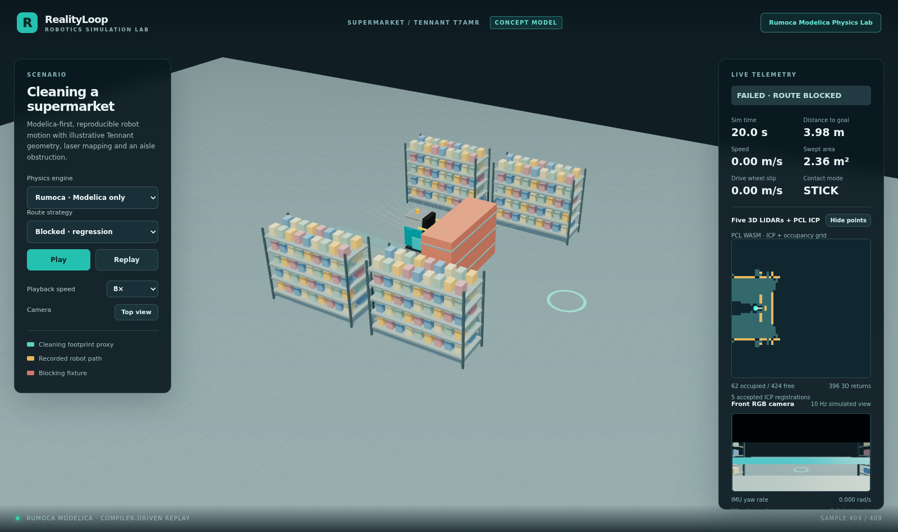

# RealityLoop

Standalone, repeatable robot simulation and agent-evaluation prototype, using a Tennant T7AMR-inspired supermarket scrubber. **Not manufacturer CAD, BrainOS software or validated autonomous navigation.**

## Run

```sh
npm ci
npm run dev                 # http://127.0.0.1:5173/
npm run check && npm test
npm run build && npm run build:web
```

The supermarket viewer defaults to a compiled Rumoca/Modelica plant. It also offers a legacy Rapier physics comparison. The Modelica plant integrates chassis motion, front-wheel steering and static/kinetic slip, with **all five shelf/aisle rectangles as physical contact obstacles**. Collision is an analytic circular-footprint/box penalty model, not general 3D manifold contact. The current fixed detour can still scrape shelves (up to approximately 0.16 m of compliant overlap in the current test)—**it does not yet meet collision-clearance safety criteria**.

The sensor visualization now includes **five multi-elevation 3D LiDAR point clouds**, 2D occupancy mapping with **PCL.js WASM ICP** scan registration, a rendered front RGB camera, synthetic IMU readings and wheel-encoder samples. Rear RGB and front depth streams have timestamped frame/calibration *metadata*, but **no real depth image or rear RGB pixels yet**. The localization system is a 2D scan-registration/odometry front end with occupancy mapping, not a full 3D SLAM/loop-closure engine. Sensor placements are illustrative rather than Tennant-sourced.



### Independent MuJoCo collision-only WASM reference

The official `@mujoco/mujoco@4.0.1` WASM module is available as an **optional collision-only reference**, separate from Rumoca. `src/mujoco-collision.ts` loads shelf/obstacle geometry, calls `mj_kinematics` then `mj_collision` for each input pose and returns penetrating contacts with outward normals. It never calls `mj_step`; it does **not** integrate a second physics state. Tests verify all five obstacles, sign conventions and repeatability.

For the desired standard Modelica boundary:

- `modelica/RealityLoopMuJoCo.mo`: conceptual Modelica `ExternalObject` and `external "C"` API.
- `native/realityloop_mujoco.h`, `native/realityloop_mujoco.c`: C ABI shim implementing persistent MuJoCo scene and geometry-only contact queries.

**Important:** these C bindings are *not linked into the current Rumoca WASM simulator*. In this pinned Rumoca build even a minimal `external "C"` runtime probe fails; native/WASM external-library linking and `ExternalObject` lifecycle support must be implemented and verified before the Modelica package is executable. The C shim itself is not compiled or linked in current CI; refer to `native/README.md`. Do not advertise MuJoCo as the default physics engine.

## Headless scenarios

```sh
npm run sim -- scenarios/modelica-supermarket-detour.json runs/modelica-detour
npm run sim -- scenarios/modelica-supermarket-blocked.json runs/modelica-blocked # expected exit 1
npm run sim -- scenarios/modelica-wheel-breakaway.json runs/contact
npm run sim -- scenarios/tennant-detour.json runs/rapier-detour
```

Results are machine-readable, include model and runtime identity and are checked with actual compiler-produced observations. The browser also has a separate Modelica wheel-slip comparison at `/drive-lab.html`.

## Known limitations and priorities

1. **Priority 1:** route clearance, physical collision normals and penetration reduction; the current planar model is an approximation.
2. **Priority 2:** general-purpose Rumoca external-C ABI + native/WASM symbol resolution, then make MuJoCo/Rapier contact queries replaceable Modelica packages without double integration.
3. **Priority 3:** robust 3D SLAM/pose graph and loop closure, realistic RGB/depth camera outputs, calibrated sensor timing/noise/bias, and IMU-wheel-LiDAR fusion.
4. **Later:** accurate Tennant drivetrain/tire calibration, responsive sensor-based navigation, additional safety checks and BrainOS/ROS adapters.

RealityLoop is an independent local Git submodule at `realityloop/`. **No changes are pushed automatically.** Root requirements and project proposal remain in `../SYSTEM_DEFINITION.csv` and `../proposals/realityloop-simulator-v071.md`.
