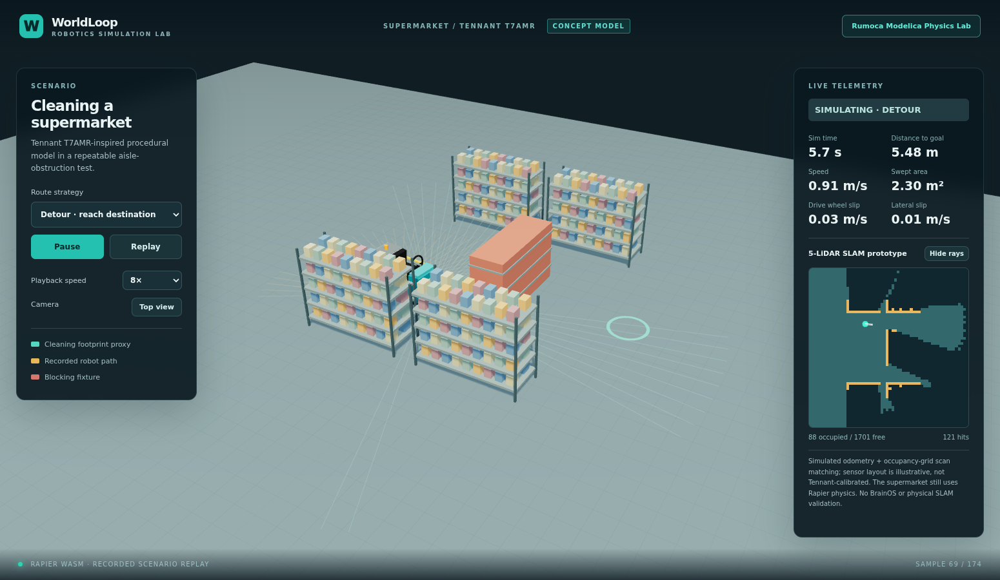

# RealityLoop

Standalone, ownable robotics simulation and repeatable AI-agent verification. **Current version:** v0.7.1 prototype, not Tennant/BrainOS certified software.

## Run both browser demonstrations

```sh
npm ci
npm run dev                   # http://127.0.0.1:5173
npm run build:web             # both pages + optional Rumoca WASM asset in dist-web
```

- **Supermarket** (`/`): editable Tennant T7AMR-inspired ride-on scrubber and fixtures, realistic *approximate* physical envelope, replayable blocked/detour navigation, cleaning-footprint coverage and live diagnostics. **Rapier WASM** still integrates the rigid body and collisions; the drivetrain parameters are uncalibrated.
- **Five simulated LiDARs**: one forward scanner and **two compact sensors on each side** as requested. World-level ray intersection, occupancy-grid map, synthetic wheel odometry, elementary scan matching and interactive scan-ray/occupancy-map visualization. Device positions/FOV are **illustrative**, not extracted from Tennant CAD or BrainOS. SLAM is an experimental 2D prototype, not a verified real-world navigation stack.
- **Modelica Wheel-Slip Lab** (`/drive-lab.html`): **Rumoca WASM** directly compiles the Modelica equations, including the reusable `RealityLoopContacts.LongitudinalStickSlip` component: ideal sticking reaction under static friction, signed kinetic sliding after breakaway, and re-sticking when slip returns to zero. The component is used in a front-steered Tennant concept and a wheel bench; the older smooth-`tanh` Modelica plants remain comparison cases.




## Headless verification

```sh
npm run check
npm test
npm run build
npm run sim -- scenarios/tennant-detour.json runs/tennant
npm run sim -- scenarios/modelica-tennant-stick-slip.json runs/traction
npm run sim -- scenarios/modelica-wheel-breakaway.json runs/contact
npm run sim -- scenarios/tennant-blocked.json runs/blocked # intentionally exits 1
```

Scenarios are bounded and schema-validated. Every run emits machine-readable `result.json` with engine identity and observations. The pinned `@taskyon/rumoca@0.10.3-taskyon.1` compiles both browser and Node Modelica fixtures without a Python runtime. The optional compiler WASM is ~35 MB; the supermarket page does not require it.

## Model and safety boundaries

**Two independent simulators are currently in use.** The supermarket uses Rapier dynamics/collisions, with synthetic LiDAR and mapping; the physics lab runs compiled Modelica wheel plants through Rumoca **without collision geometry**. These are *not* one combined physical simulation. Longer term, Modelica/Rumoca should own body, wheel and contact dynamics, invoking a replaceable collision backend through standard Modelica `external "C"`; candidates include Rapier collision-only and Rumoca's developing native collision engine.

The static/kinetic contact component is an idealized 1D planar Coulomb law with a discrete friction mode. It does not simulate combined lateral slip, tire relaxation, deformation, floor film, suspension, calibration or contact impulse manifolds. The stick transition uses a small velocity tolerance (1e-6 m/s). This is a numerical/behavioral prototype, **not a measurement of Tennant tire characteristics**. Published approximate T7AMR external dimensions are 1.651 m length, 0.889 m width, 1.499 m height and 479 kg mass; full physical validation and real sensor extrinsics remain pending. [Tennant specifications](https://www.tennantco.com/en_us/1/machines/scrubbers/product.t7amr.robotic-floor-scrubber.2000056.html).

The repository is intended to be used as a Git submodule of the parent Taskyon workspace at `realityloop/`, with its own independent versioning and CI. It runs without Taskyon login, Space or cloud. See the parent `SYSTEM_DEFINITION.csv` and `proposals/worldloop-simulator-v071.md` (historical proposal path).
